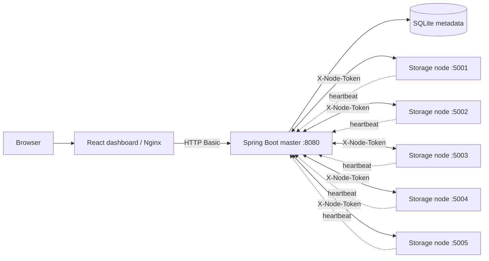
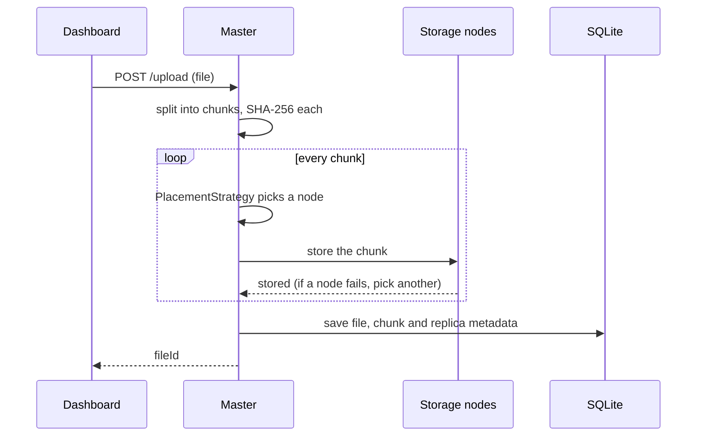
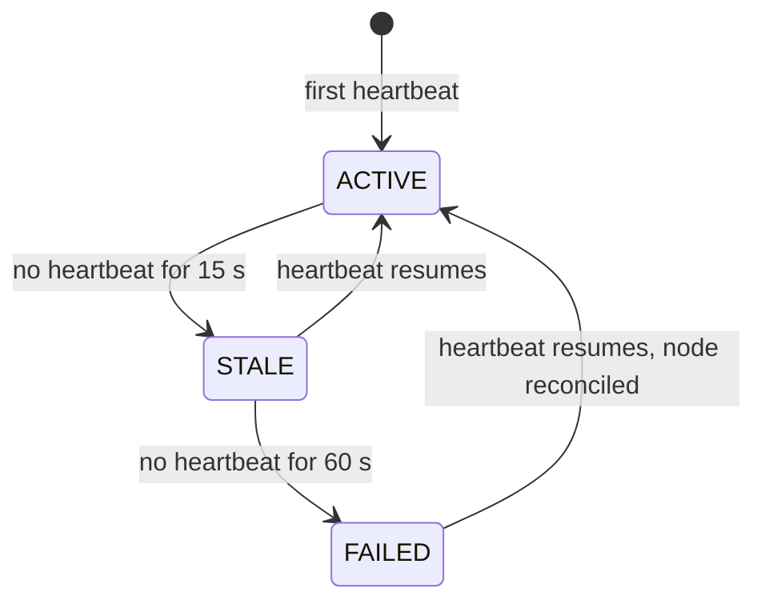
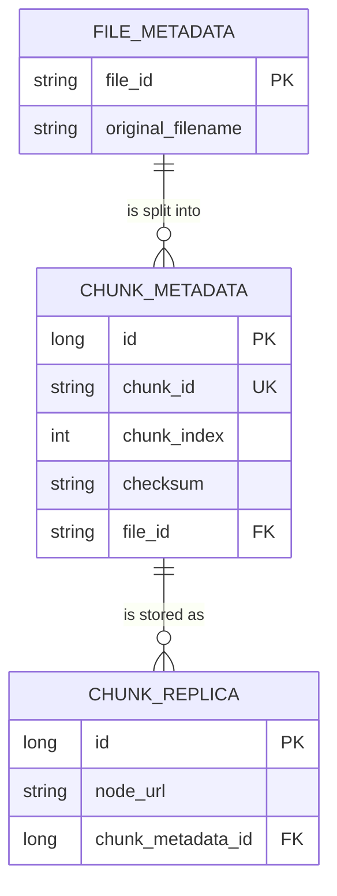

<div align="center">

# 🌾 ByteHarvest

**A distributed chunk-storage system built from scratch: files are split, checksummed, replicated across nodes, and automatically repaired when a node dies.**

[](https://github.com/Basavaraj8143/distributed-storage-system/actions/workflows/ci.yml)


</div>

ByteHarvest follows the same core idea as **HDFS** and the **Google File System**: one master keeps the metadata, many storage nodes keep the data, and every chunk lives on more than one node. Pull the plug on a node and the cluster notices, keeps serving files from the surviving copies, and re-creates the missing ones.

It is a learning project. It is small enough to read in a weekend and real enough to show the problems that distributed storage has to solve.

## Highlights

- **Chunked storage.** Uploads are split into fixed-size chunks (1 MiB by default, configurable) and spread across five storage nodes.
- **Replication.** Every chunk is stored on 2 different nodes by default (`STORAGE_REPLICATION_FACTOR`).
- **Integrity.** Each chunk has a SHA-256 checksum. Corrupt copies are detected on download and repaired from a healthy replica.
- **Failure detection.** Nodes send heartbeats. The master tracks them as `ACTIVE`, `STALE` and `FAILED`.
- **Self-healing.** When a node fails, a repair cycle re-replicates its chunks. When a node rejoins, the master reconciles what it holds against the metadata.
- **Secured.** HTTP Basic login for users, plus a shared token between the master and the nodes. Both services refuse to start without their secrets.
- **Operator dashboard.** Live file list with replica health, upload progress, node status, logs, and a **Chaos Simulator** that takes nodes offline so you can watch the cluster react.
- **Runs anywhere.** One `docker compose up`, or the services as separate processes in your IDE.

## How it works



The master stores only metadata (which file has which chunks, and which nodes hold each chunk). The nodes store the chunk bytes as plain files.

### An upload



A download reverses it: the master reads the chunk list, fetches each chunk from a node, **verifies its checksum**, falls back to another replica if a copy is missing or corrupt, and streams the reassembled file.

### Node health



| State | What the master does |
| --- | --- |
| `ACTIVE` | Normal. Receives new chunks. |
| `STALE` | Heartbeats stopped. No new uploads go here, but its replicas are kept in case it is only slow. |
| `FAILED` | Considered gone. Its replica records are dropped and the repair cycle copies the affected chunks to other nodes. |

Both timeouts are configurable.

## Quick start

Prerequisite: Docker with the Compose plugin.

```bash
git clone https://github.com/Basavaraj8143/distributed-storage-system.git
cd distributed-storage-system
cp .env.example .env      # then edit .env: set APP_PASSWORD and NODE_TOKEN
docker compose up --build
```

Open **http://localhost:5173** and sign in with `APP_USERNAME` (default `admin`) and your `APP_PASSWORD`. All five nodes should show `ACTIVE` on the Node Status page within about 15 seconds.

`NODE_TOKEN` is a secret shared by the master and all nodes (at least 16 characters). Generate one with `openssl rand -hex 32`; `.env.example` also has a PowerShell one-liner. `.env` is git-ignored.

Stop with `docker compose down` (add `-v` to delete the stored data too).

**Try it:** upload a file, open **Files** and see `2/2` replicas, then open the **Chaos Simulator**, take a node offline, and watch it go `STALE`, then `FAILED`, then watch the repair restore the replica count.

**Running from IntelliJ without Docker?** See [docs/rebuild/running-locally.md](docs/rebuild/running-locally.md) for the exact environment variables for the master and each of the five nodes.

## The dashboard

| Page | What it does |
| --- | --- |
| Dashboard | Cluster health summary, refreshed automatically |
| Upload | Size and empty-file checks, live progress bar, copy the file ID |
| Files | Download, delete, and inspect every chunk and where it lives. Files with missing copies are flagged `UNDER-REPLICATED` or `NO COPIES`. |
| Node Status | Every node's state and last heartbeat |
| Logs | Structured event stream and a tail of the master log |
| Chaos Simulator | Take nodes offline and online, and watch the event timeline |

## Design highlights

The code is organised so that each change has one obvious place to go.

| Idea | Where | Why it matters |
| --- | --- | --- |
| Single responsibility | `UploadService`, `DownloadService`, `FileManagementService`, `ChunkRepairService` | One large service was split by job, so a change touches one small class. |
| Strategy pattern | `PlacementStrategy` and `RandomPlacementStrategy` | Choosing where a chunk goes is pluggable. A new strategy is one class and one property (`storage.placement-strategy`). |
| Gateway and dependency inversion | `StorageNodeClient` (interface) and `RestStorageNodeClient` | Services do not know HTTP. Swapping the transport touches one class, and the node token is added in one place. |
| Validated configuration | `StorageProperties`, `AuthProperties`, `NodeAuthProperties` | Bad settings (replication factor above the node count, missing password, short token) stop the app at startup with a clear message. |
| Database integrity | Unique indexes on `(file_id, chunk_index)` and `(chunk_metadata_id, node_url)` | The database refuses duplicate chunks and duplicate replicas, whatever the code does. |
| Behaviour on the entity | `ChunkMetadataEntity.replicaUrls()` | Logic that belongs to a chunk lives on the chunk. |

### Data model



## Security

| Path | Protection |
| --- | --- |
| User to master | HTTP Basic (`APP_USERNAME` / `APP_PASSWORD`). The password is hashed with BCrypt in memory. Stateless, with no sessions. |
| Node to master | `POST /heartbeat` is rejected unless it carries the correct `X-Node-Token`. |
| Master to node | Every node endpoint is rejected unless it carries the same `X-Node-Token`. |
| Startup | The master and the nodes refuse to start without their secrets. There are no default passwords. |

The token is compared in constant time. The user login does not work on `/heartbeat`, and the node token does not work on `/files`.

**Honest limits:** traffic is plain HTTP unless you add TLS, the node token is one secret shared by the whole cluster, there is one shared login rather than user accounts, and chunks are not encrypted on disk. See [Roadmap](#roadmap) and [docs/rebuild/authentication-phase2.md](docs/rebuild/authentication-phase2.md).

## Configuration

| Setting | Default | Purpose |
| --- | --- | --- |
| `APP_USERNAME` | `admin` | HTTP Basic username for the dashboard and master API |
| `APP_PASSWORD` | Required | HTTP Basic password. The master does not start without it. |
| `NODE_TOKEN` | Required | Shared token for master-to-node and node-to-master requests (minimum 16 characters). Same value everywhere. |
| `STORAGE_NODES` | `http://localhost:5001` to `:5005` | Comma-separated storage node URLs |
| `STORAGE_REPLICATION_FACTOR` | `2` | Copies kept of every chunk. Cannot exceed the number of nodes. |
| `STORAGE_CHUNK_SIZE_BYTES` | `1048576` | Chunk size for new files (1 MiB, minimum 1024). Existing files keep the size they were stored with. |
| `SPRING_DATASOURCE_URL` | `jdbc:sqlite:metadata.db` | Master SQLite connection string |
| `HEARTBEAT_STALE_TIMEOUT_MS` | `15000` | Silence before a node is `STALE` |
| `HEARTBEAT_DEAD_TIMEOUT_MS` | `60000` | Silence before a node is `FAILED` (must exceed the stale timeout) |
| `HEARTBEAT_MASTER_URL` | `http://localhost:8080/heartbeat` | Where a node sends its heartbeat |
| `STORAGE_BASE_DIR` | working directory | Base directory for a node's chunk folder |
| `VITE_API_BASE_URL` | `http://localhost:8080` | Dashboard API URL, set at frontend build time |

Uploads are limited to 10 MB by the master's multipart configuration. See [`.env.example`](.env.example) for the Compose variables.

## API overview

All master endpoints need HTTP Basic credentials, except `POST /heartbeat`, which needs the node token. Storage-node endpoints are internal and need the `X-Node-Token` header.

| Method | Endpoint | Purpose |
| --- | --- | --- |
| `POST` | `/upload` | Upload multipart field `file`; returns the file ID |
| `GET` | `/download/{fileId}` | Reassemble and download a file |
| `GET` | `/files` | List stored files with replica counts |
| `GET` | `/files/{fileId}` | File details with every chunk and its nodes |
| `DELETE` | `/files/{fileId}` | Delete a file and its replicas |
| `POST` | `/heartbeat` | Receive a node heartbeat (node token) |
| `GET` | `/nodes/status` | Known nodes and their state |
| `GET` | `/system/health` | Cluster health summary |
| `GET` | `/logs?level=ALL&limit=100` | Recent application events |
| `GET` | `/logs/master?lines=500` | Tail of the master log |
| `POST` | `/api/simulation/nodes/{nodeId}/offline` | Simulate a node going offline |
| `POST` | `/api/simulation/nodes/{nodeId}/online` | Bring a simulated node back |

```bash
curl -u admin:YOUR_PASSWORD -F "file=@sample.pdf" http://localhost:8080/upload
curl -u admin:YOUR_PASSWORD -L "http://localhost:8080/download/FILE_ID" -o downloaded.pdf
curl -u admin:YOUR_PASSWORD http://localhost:8080/system/health
```

Full details are in [docs/api/endpoints.md](docs/api/endpoints.md), and a ready-made [Postman collection](docs/postman/byteharvest-api.postman_collection.json) is included. (On Windows PowerShell, use `curl.exe`.)

## Project layout

```text
.
├── master-service/     Spring Boot master: API, placement, repair, SQLite metadata
├── storage-node/       Spring Boot node: stores and serves chunk files, sends heartbeats
├── client-ui/          React 18 + Vite dashboard
├── deploy/             Nginx config for the production-style setup
├── docs/               API, deployment, rebuild notes, planning history, Postman
├── compose.yaml        Local cluster: master, 5 nodes, dashboard
├── compose.prod.yaml   Single-server setup: only Nginx is exposed
└── .github/workflows/  CI
```

| Component | Technology |
| --- | --- |
| Master and nodes | Java 17, Spring Boot 3.5, Spring Security (master), Maven |
| Metadata | SQLite with Spring Data JPA |
| Dashboard | React 18, React Router, Vite |
| Packaging | Docker Compose, Nginx |
| CI | GitHub Actions |

## Tests and CI

```bash
cd master-service && mvn test
cd ../storage-node && mvn test
cd ../client-ui && npm ci && npm run build
```

The tests need no environment variables; they set their own password and token. GitHub Actions runs the frontend build, the tests and packaging of both services, and the three Docker image builds on every push and pull request. See [docs/ci-pipeline.md](docs/ci-pipeline.md).

## Production-style deployment

`compose.prod.yaml` publishes only Nginx on port 80 and keeps the master and nodes on the internal Docker network. Create `deploy/.htpasswd` with the **same** username and password as `APP_USERNAME` and `APP_PASSWORD`, then:

```bash
docker compose -f compose.prod.yaml up -d --build
```

Server setup notes (Oracle Cloud Always Free) are in [docs/deployment/oracle-cloud.md](docs/deployment/oracle-cloud.md).

## How it compares to HDFS

| | ByteHarvest | HDFS |
| --- | --- | --- |
| Block / chunk size | 1 MiB (configurable) | 128 MB by default |
| Default replicas | 2 | 3 |
| Metadata | Master with SQLite | NameNode (in memory, with an edit log) |
| Placement | Random, behind a strategy interface | Rack-aware |
| Master failover | None | Standby NameNode |
| Aimed at | Learning, small files | Huge files, batch analytics |

## Roadmap

Planned, in rough priority order:

- [ ] TLS between the master and the nodes, so the token and data are encrypted in transit
- [ ] Atomic uploads: a file status (`UPLOADING` / `COMPLETE`) and cleanup of failed uploads
- [ ] Validate the heartbeat's `nodeUrl` against the configured storage nodes
- [ ] Capacity-aware placement: report disk space in the heartbeat
- [ ] Rate-limit failed logins and log failed authentication attempts
- [ ] User accounts with JWT and per-user file ownership

## Known limitations

- The master is a single point of failure. Master replication and leader election are not implemented.
- Placement is random. It does not consider free space, racks or zones yet.
- Uploads are not atomic yet: a failure halfway can leave orphan chunks on nodes.
- Lowering the replication factor does not remove copies that already exist.
- Chunks and metadata are not encrypted at rest, and there is no TLS unless you add it at the deployment boundary.
- Intended for learning and demonstrations, not production workloads.

## More documentation

- [Documentation index](docs/README.md)
- Rebuild notes: [running locally](docs/rebuild/running-locally.md), [service split](docs/rebuild/service-split.md), [placement strategy](docs/rebuild/placement-strategy.md), [configurable replication](docs/rebuild/configurable-replication.md), [repair cycle](docs/rebuild/Repair-cycle.md), [authentication phase 1](docs/rebuild/authentication-phase1.md) and [phase 2](docs/rebuild/authentication-phase2.md)

## Team

**Byte-Harvest**: final-year Computer Science Engineering project at KLE Institute of Technology, 2026–27.

| Member | Focus |
| --- | --- |
| Basavaraj N | Architecture, backend, integration |
| Akash M K | Storage node and local deployment |
| Ishan Patil | Master service and fault detection |
| Disha H | Client interface and documentation |

## License

No `LICENSE` file is present in the repository yet. Add one (for example MIT) to make the terms explicit.
