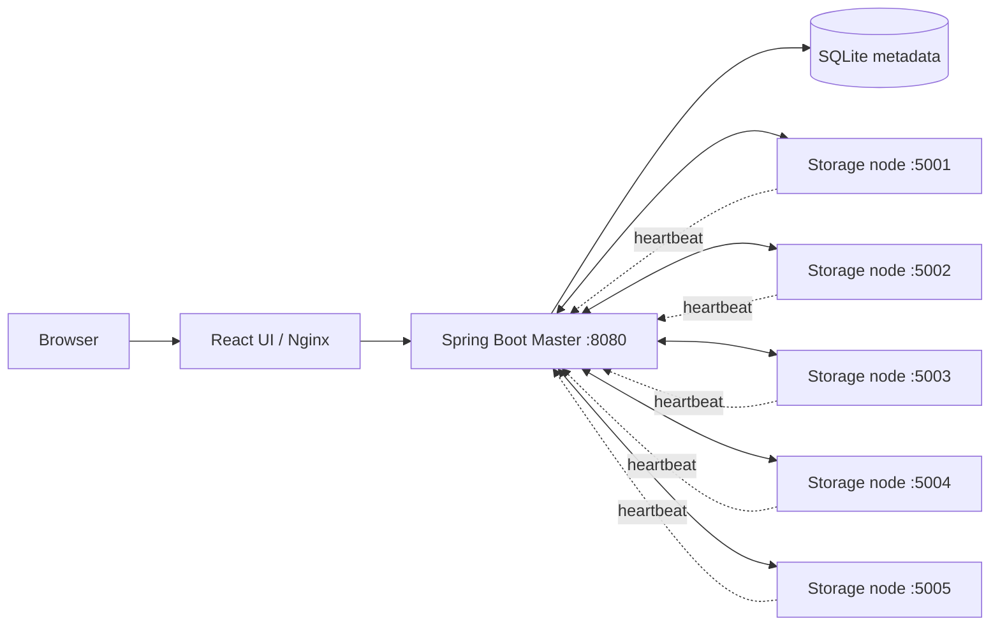

# ByteHarvest Distributed Storage System

ByteHarvest is a learning project that stores files as chunks across multiple storage nodes. A Spring Boot master coordinates chunk placement, metadata, downloads, node health, and replica repair. A React dashboard provides the operator interface.

## Features

- Splits uploads into configurable chunks and stores replicas on separate nodes.
- Records file, chunk, replica, and checksum metadata in SQLite.
- Uses SHA-256 checksums to detect corrupt replicas during download and repair.
- Receives node heartbeats, reports `ACTIVE`, `STALE`, and `FAILED` states, and repairs missing replicas when possible.
- Provides an authenticated dashboard for files, cluster health, logs, and node failure simulation.
- Runs locally with Docker Compose or as separate Java and Node.js processes.

## Architecture



The master is the metadata coordinator and a single point of failure. Storage nodes hold chunk files; the master records where replicas are stored.

## Repository Layout

```text
.
|-- client-ui/          # React 18 and Vite dashboard
|-- master-service/     # Spring Boot API, coordination, and SQLite metadata
|-- storage-node/       # Spring Boot chunk storage service
|-- deploy/             # Production reverse-proxy configuration
|-- docs/               # API, CI, deployment, and project documentation
|-- compose.yaml        # Local Docker Compose cluster
|-- compose.prod.yaml   # Single-server production-style Compose setup
`-- README.md
```

## Technology

| Component | Technology |
| --- | --- |
| Master and storage nodes | Java 17, Spring Boot, Maven |
| Metadata | SQLite, Spring Data JPA |
| Dashboard | React 18, React Router, Vite |
| Container setup | Docker Compose, Nginx |
| CI | GitHub Actions |

## Run Locally with Docker Compose

Prerequisites: Docker with the Compose plugin.

1. From the repository root, copy `.env.example` to `.env`.
2. Set a non-empty `APP_PASSWORD` and a `NODE_TOKEN` of at least 16 characters in `.env`. The node token is shared by the master and all storage nodes. Keep `.env` private; it is not committed.
3. Start the cluster:

   ```bash
   docker compose up --build
   ```

4. Open the dashboard at [http://localhost:5173](http://localhost:5173) and sign in with `APP_USERNAME` and `APP_PASSWORD` from `.env` (the default username is `admin`). The master API is at [http://localhost:8080](http://localhost:8080).

Compose starts the master, dashboard, and five storage nodes. Metadata and node chunk data use named volumes and persist across container restarts. Stop with `Ctrl+C`, then run `docker compose down`. `docker compose down -v` also deletes the persisted volumes.

## Run Services without Docker

Prerequisites: Java 17, Maven, Node.js 24, and npm. The master and each storage node require a password and shared node token; provide them as environment variables before starting. The master accepts `APP_USERNAME` (default `admin`), `APP_PASSWORD`, `NODE_TOKEN`, and optionally `STORAGE_NODES`. Each node needs the same `NODE_TOKEN`; configure its port and heartbeat URL as needed.

Start the master from the repository root:

```powershell
$env:APP_PASSWORD = "your-local-password"
$env:NODE_TOKEN = "replace-with-a-random-token-at-least-16-chars"
cd master-service
mvn spring-boot:run
```

Start each storage node in its own terminal, from the repository root. Repeat for ports 5001 through 5005; set the master URL and node URL for the selected port if they differ from these defaults:

```powershell
$env:NODE_TOKEN = "replace-with-a-random-token-at-least-16-chars"
$env:SERVER_PORT = "5001"
$env:STORAGE_NODE_URL = "http://localhost:5001"
$env:HEARTBEAT_MASTER_URL = "http://localhost:8080/heartbeat"
cd storage-node
mvn spring-boot:run
```

Run the dashboard in another terminal:

```bash
cd client-ui
npm ci
npm run dev
```

The development dashboard uses `http://localhost:8080` as its API base by default. Start the master and storage nodes before uploading files.

## Production-style Compose

`compose.prod.yaml` serves the dashboard through Nginx on port 80 and keeps the master and storage nodes on the internal Docker network. Configure the root `.env` as above, then create `deploy/.htpasswd` with the same username and password used for `APP_USERNAME` and `APP_PASSWORD`. See [docs/deployment/oracle-cloud.md](docs/deployment/oracle-cloud.md) for server setup details.

```bash
docker compose -f compose.prod.yaml up -d --build
```

## Configuration

| Setting | Default | Purpose |
| --- | --- | --- |
| `APP_USERNAME` | `admin` | HTTP Basic username for dashboard and master API |
| `APP_PASSWORD` | Required | HTTP Basic password; the master does not start without it |
| `NODE_TOKEN` | Required | Shared token for master-to-node and node-to-master requests; minimum 16 characters |
| `STORAGE_NODES` | `http://localhost:5001` through `:5005` | Comma-separated storage node URLs |
| `STORAGE_REPLICATION_FACTOR` | `2` | Number of copies to maintain; cannot exceed available nodes |
| `STORAGE_CHUNK_SIZE_BYTES` | `1048576` | Chunk size for new files (1 MiB; minimum 1024 bytes) |
| `SPRING_DATASOURCE_URL` | `jdbc:sqlite:metadata.db` | Master SQLite connection string |
| `HEARTBEAT_STALE_TIMEOUT_MS` | `15000` | Time since heartbeat before a node is stale |
| `HEARTBEAT_DEAD_TIMEOUT_MS` | `60000` | Time since heartbeat before a node is failed; must exceed stale timeout |
| `HEARTBEAT_MASTER_URL` | `http://localhost:8080/heartbeat` | Master heartbeat endpoint configured on storage nodes |
| `STORAGE_BASE_DIR` | Current working directory | Base directory for node chunk folders |
| `VITE_API_BASE_URL` | `http://localhost:8080` | Dashboard API URL; set at frontend build time |

Uploads are limited to 10 MB by the master’s multipart configuration. Existing files retain the chunk size they were stored with. See [`.env.example`](.env.example) for the local Compose variables; it contains placeholders, not credentials.

## API Overview

All master endpoints require HTTP Basic authentication except `POST /heartbeat`, which is authenticated with the shared node token. For a direct API call, use `curl -u USERNAME:PASSWORD`. The storage node endpoints are internal cluster APIs and use the `X-Node-Token` header.

| Method | Endpoint | Purpose |
| --- | --- | --- |
| `POST` | `/upload` | Upload multipart field `file`; returns the generated file ID |
| `GET` | `/download/{fileId}` | Reconstruct and download a file |
| `GET` | `/files` | List stored files |
| `GET` | `/files/{fileId}` | Get file and chunk details |
| `DELETE` | `/files/{fileId}` | Delete a file and its stored replicas |
| `POST` | `/heartbeat` | Receive a node heartbeat (node token required) |
| `GET` | `/nodes/status` | List known nodes and their health state |
| `GET` | `/system/health` | Cluster health summary |
| `GET` | `/logs?level=ALL&limit=100` | Recent in-memory application events |
| `GET` | `/logs/master?lines=500` | Tail of the master log file |
| `POST` | `/api/simulation/nodes/{nodeId}/offline` | Simulate a node going offline |
| `POST` | `/api/simulation/nodes/{nodeId}/online` | Restore a simulated node |

See [docs/api/endpoints.md](docs/api/endpoints.md) for request and response details.

Example upload and download:

```bash
curl -u admin:YOUR_PASSWORD -F "file=@sample.pdf" http://localhost:8080/upload
curl -u admin:YOUR_PASSWORD -L "http://localhost:8080/download/FILE_ID" -o downloaded-file.pdf
curl -u admin:YOUR_PASSWORD http://localhost:8080/system/health
```

Storage node routes include `POST /storeChunk`, `GET /getChunk/{chunkId}`, `GET /chunks`, and `DELETE /deleteChunk/{chunkId}`; requests carry the shared `X-Node-Token` header.

## Build and CI

Run backend tests and build the frontend:

```bash
cd master-service && mvn -B --no-transfer-progress test
cd ../storage-node && mvn -B --no-transfer-progress test
cd ../client-ui && npm ci && npm run build
```

GitHub Actions runs frontend build and backend tests/package steps on pushes to `main` or `master`, and on pull requests. See [`.github/workflows/ci.yml`](.github/workflows/ci.yml) and [docs/ci-pipeline.md](docs/ci-pipeline.md).

## Current Limitations

- The master is a single point of failure; master replication and leader election are not implemented.
- Replica placement currently uses a random strategy and does not account for racks or zones.
- Storage nodes write chunk data as local files; the system is intended for learning and demonstrations, not production workloads.
- The master API uses HTTP Basic credentials, and node traffic uses a shared token. Configure HTTPS at the deployment boundary for remote use.

## Team and Academic Context

**Byte-Harvest** — final-year Computer Science Engineering project at KLE Institute of Technology, 2026–27.

| Member | Focus |
| --- | --- |
| Basavaraj N | Architecture, backend, integration |
| Akash M K | Storage node and local deployment |
| Ishan Patil | Master service and fault detection |
| Disha H | Client interface and documentation |

## License

The project has historically been described as MIT licensed. Add or consult the repository’s `LICENSE` file to confirm the license terms; no root `LICENSE` file is currently present.
