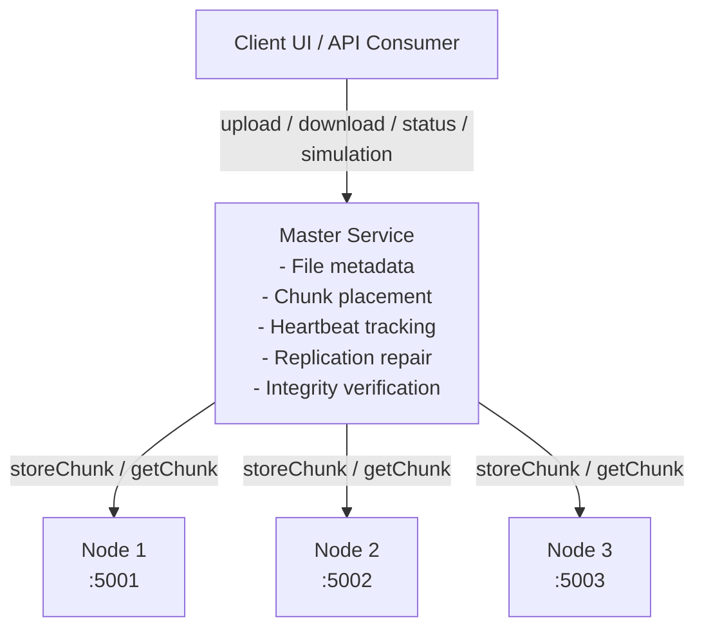

# ByteHarvest Distributed Storage System

A final-year distributed systems project demonstrating chunk-based file storage, metadata coordination, replication, node health monitoring, and self-healing recovery - inspired by GFS and HDFS, but small enough to run and understand on a single developer machine.


---

## Table of Contents

- [Highlights](#highlights)
- [Architecture](#architecture)
- [Repository Structure](#repository-structure)
- [Tech Stack](#tech-stack)
- [Services and Ports](#services-and-ports)
- [Quick Start](#quick-start)
- [Core Workflow](#core-workflow)
- [API Overview](#api-overview)
- [Example cURL Commands](#example-curl-commands)
- [Configuration](#configuration)
- [Testing and Build](#testing-and-build)
- [CI/CD](#cicd)
- [Implemented Concepts](#implemented-concepts)
- [Known Limitations](#known-limitations)
- [Roadmap](#roadmap)
- [Team](#team)
- [Academic Context](#academic-context)
- [License](#license)

---

## Highlights

- Splits uploaded files into 1 MB chunks.
- Stores chunk metadata in SQLite through the master service.
- Replicates each chunk across multiple storage nodes.
- Tracks node health with periodic heartbeats.
- Detects failed nodes and repairs under-replicated chunks.
- Verifies chunk integrity with SHA-256 and repairs corrupt replicas.
- Provides a React dashboard for upload, download, node status, simulation, and logs.

## Architecture



## Repository Structure

```text
.
├── client-ui/          # React and Vite operator dashboard
├── master-service/     # Spring Boot master service and SQLite metadata layer
├── storage-node/       # Spring Boot storage node service
├── docs/               # API, setup, CI, planning, and progress notes
├── .github/workflows/  # GitHub Actions CI workflow
├── metadata.db          # Local SQLite metadata database
└── README.md
```

## Tech Stack

| Area | Technology |
| --- | --- |
| Master service | Java 17, Spring Boot, Spring Web, Spring Data JPA |
| Storage nodes | Java 17, Spring Boot Web MVC |
| Metadata database | SQLite |
| Frontend | React 18, Vite |
| Testing | JUnit, Spring Boot Test, Mockito |
| CI | GitHub Actions |

## Services and Ports

| Service | Default URL | Purpose |
| --- | --- | --- |
| Frontend | `http://localhost:5173` | Browser dashboard |
| Master service | `http://localhost:8080` | Upload/download API, metadata, monitoring |
| Storage node 1 | `http://localhost:5001` | Chunk storage |
| Storage node 2 | `http://localhost:5002` | Chunk storage |
| Storage node 3 | `http://localhost:5003` | Chunk storage |

The master is configured to use storage nodes on ports `5001`, `5002`, and `5003` in [application.properties](master-service/src/main/resources/application.properties).

## Quick Start

### Prerequisites

- Java 17 or newer
- Maven 3.9 or newer
- Node.js 20 or newer
- npm

### 1. Start the Master Service

```bash
cd master-service
mvn spring-boot:run
```

The master starts on `http://localhost:8080`.

### 2. Start Storage Nodes

Open three separate terminals:

```bash
cd storage-node
mvn spring-boot:run -Dspring-boot.run.arguments="--server.port=5001"
```

```bash
cd storage-node
mvn spring-boot:run -Dspring-boot.run.arguments="--server.port=5002"
```

```bash
cd storage-node
mvn spring-boot:run -Dspring-boot.run.arguments="--server.port=5003"
```

Each node stores chunks in a local folder named after its port, such as `storage_5001/`.

### 3. Start the Frontend

```bash
cd client-ui
npm install
npm run dev
```

Open `http://localhost:5173` in your browser.

> **Tip:** start the master first, then the three storage nodes, then the frontend — nodes register with the master via heartbeat on boot.

## Core Workflow

1. Upload a file from the UI or `POST /upload`.
2. The master splits the file into 1 MB chunks.
3. Each chunk is replicated to storage nodes.
4. The master saves file, chunk, replica, and checksum metadata in SQLite.
5. Download by `fileId` reconstructs the original file in chunk order.
6. If a replica is corrupt or unreachable, the master tries another replica and repairs metadata or data where possible.

## API Overview

| Method | Endpoint | Description |
| --- | --- | --- |
| `POST` | `/upload` | Uploads a file and returns a `fileId` |
| `GET` | `/download/{fileId}` | Downloads the reconstructed original file |
| `POST` | `/heartbeat` | Receives heartbeat messages from storage nodes |
| `GET` | `/nodes/status` | Returns active, failed, or unknown node status |
| `GET` | `/system/health` | Returns cluster health summary |
| `GET` | `/logs` | Returns recent in-memory system events |
| `POST` | `/api/simulation/nodes/{nodeId}/offline` | Simulates a node failure |
| `POST` | `/api/simulation/nodes/{nodeId}/online` | Brings a simulated node back online |

Full endpoint details are available in [docs/api/endpoints.md](docs/api/endpoints.md).

## Example cURL Commands

Upload a file:

```bash
curl -X POST "http://localhost:8080/upload" \
  -F "file=@sample.pdf"
```

Download a file:

```bash
curl -L "http://localhost:8080/download/<fileId>" -o downloaded-file.pdf
```

Check cluster health:

```bash
curl "http://localhost:8080/system/health"
```

## Configuration

### Master Service

Main configuration file: [master-service/src/main/resources/application.properties](master-service/src/main/resources/application.properties)

Important values:

```properties
spring.servlet.multipart.max-file-size=10MB
spring.servlet.multipart.max-request-size=10MB
storage.nodes=http://localhost:5001,http://localhost:5002,http://localhost:5003
spring.datasource.url=jdbc:sqlite:metadata.db
```

### Storage Node

Main configuration file: [storage-node/src/main/resources/application.properties](storage-node/src/main/resources/application.properties)

Important values:

```properties
heartbeat.master-url=http://localhost:8080/heartbeat
storage.base-dir=
```

### Frontend

Runtime API settings live in [client-ui/.env](client-ui/.env).

```properties
VITE_API_BASE_URL=http://localhost:8080
VITE_USE_MOCK_API=false
```

## Testing and Build

Run backend tests:

```bash
cd master-service
mvn -B --no-transfer-progress test
```

```bash
cd storage-node
mvn -B --no-transfer-progress test
```

Build the frontend:

```bash
cd client-ui
npm run build
```

Package backend applications:

```bash
cd master-service
mvn -B --no-transfer-progress package -DskipTests
```

```bash
cd storage-node
mvn -B --no-transfer-progress package -DskipTests
```

## CI/CD

GitHub Actions runs the CI workflow in [.github/workflows/ci.yml](.github/workflows/ci.yml).

The pipeline checks:

- Frontend dependency installation and production build.
- Master service tests and packaging.
- Storage node tests and packaging.

More details are documented in [docs/ci-pipeline.md](docs/ci-pipeline.md).

## Implemented Concepts

| Concept | Status |
| --- | --- |
| Metadata-data separation | ✅ Implemented |
| Chunk-based storage | ✅ Implemented |
| Replica placement | ✅ Implemented |
| Heartbeat-based failure detection | ✅ Implemented |
| Under-replication repair | ✅ Implemented |
| SHA-256 chunk integrity checks | ✅ Implemented |
| Corrupt replica repair | ✅ Implemented |
| React monitoring dashboard | ✅ Implemented |
| Docker Compose deployment | ⏳ Not included yet |
| Master replication and consensus | 🔭 Future scope |

## Known Limitations

- The master service is a single point of failure.
- Replica placement is simple and does not use rack awareness.
- The system is built for learning and demonstration, not production traffic.
- There is no Raft, Paxos, or leader election implementation.
- Stored chunks are plain local files under node-specific folders.

## Roadmap

- [ ] Docker Compose setup for one-command local cluster startup.
- [ ] Master replication / leader election for high availability.
- [ ] Rack-aware or zone-aware replica placement.
- [ ] Configurable chunk size and replication factor.
- [ ] Authentication and access control on the API.

## Team

**Byte-Harvest**

| Member | Focus |
| --- | --- |
| Basavaraj N | Architecture, backend, integration |
| Akash M K | Storage node and local deployment |
| Ishan Patil | Master service and fault detection |
| Disha H | Client interface and documentation |

## Academic Context

This project is submitted as a final-year Computer Science Engineering project at KLE Institute of Technology for the 2026–27 academic year.

The goal is to make distributed storage concepts concrete through an end-to-end implementation that can be inspected, tested, and demonstrated locally.

## License

This project is licensed under the MIT License — see the `LICENSE` file for details. *(Add a `LICENSE` file at the repo root if one doesn't exist yet.)*