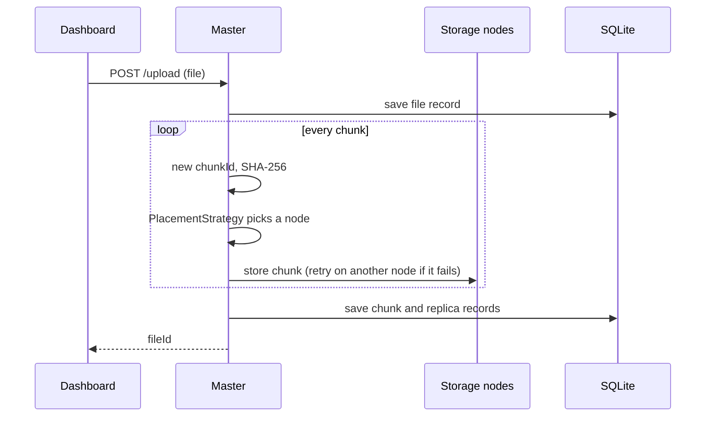
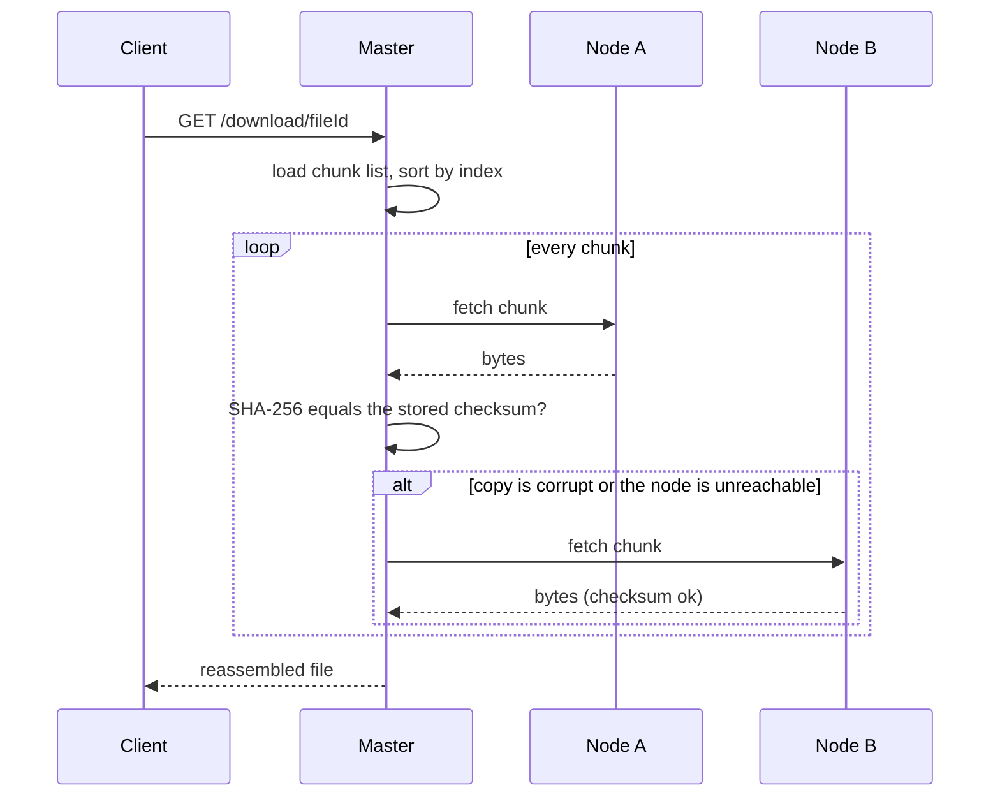
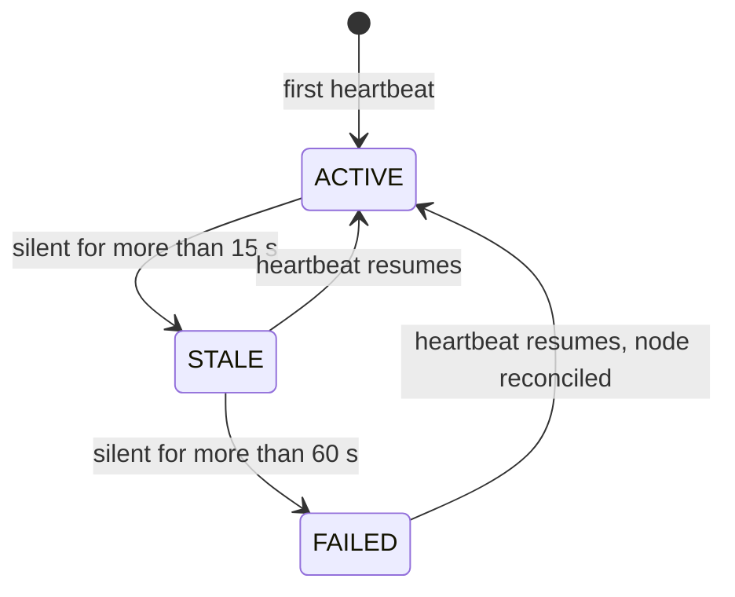
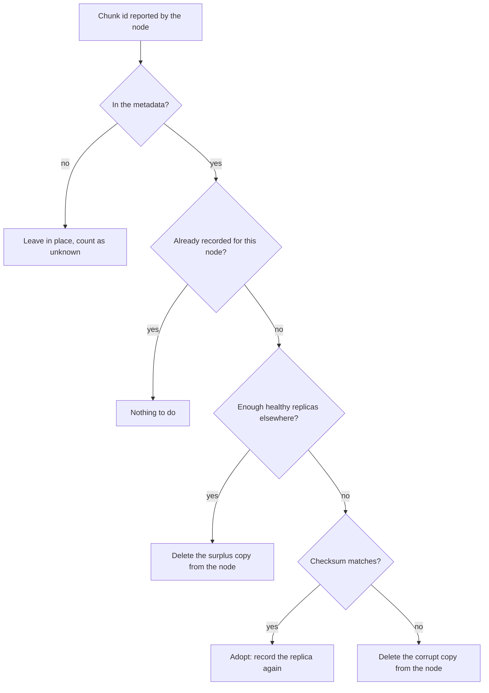
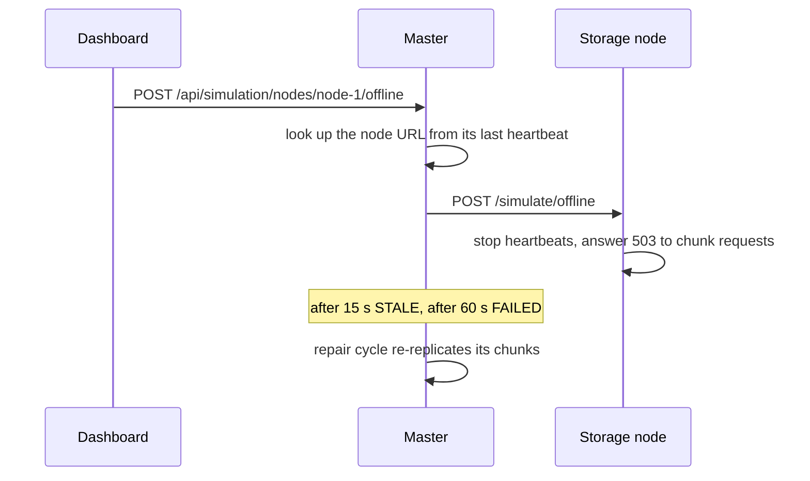

# Key flows

How ByteHarvest behaves, step by step. Each flow lists what triggers it, what happens, what happens when something fails, and which classes do the work. Everything here was checked against the master and storage-node code. The numbers (5 s, 10 s, 15 s, 60 s, 2 copies, 1 MiB) are defaults and can be configured.

| # | Flow | Triggered by | Main classes |
| --- | --- | --- | --- |
| 1 | [Upload](#1-upload) | `POST /upload` | `FileController`, `UploadService`, `PlacementStrategy`, `StorageNodeClient` |
| 2 | [Download](#2-download) | `GET /download/{fileId}` | `DownloadService` |
| 3 | [Heartbeat and node health](#3-heartbeat-and-node-health) | Every node, every 5 s | `HeartbeatSenderService` (node), `HeartbeatController`, `HeartbeatService` |
| 4 | [Node failure and repair](#4-node-failure-and-repair) | Scheduled, every 10 s | `ReplicationRepairService`, `ChunkRepairService` |
| 5 | [Node rejoin and reconcile](#5-node-rejoin-and-reconcile) | A node returns from `FAILED`, or is first seen | `HeartbeatService`, `ChunkRepairService.reconcileNode` |
| 6 | [Corruption handling](#6-corruption-handling) | Download, and the repair cycle | `DownloadService`, `ChunkRepairService` |
| 7 | [Delete](#7-delete) | `DELETE /files/{fileId}` | `FileManagementService` |
| 8 | [Authentication](#8-authentication) | Every request | `SecurityConfig`, `NodeTokenFilter` |
| 9 | [Chaos simulation](#9-chaos-simulation) | Dashboard button | `SimulationController` (master), `SimulationController` (node) |
| 10 | [Startup validation](#10-startup-validation) | Application start | `StorageProperties`, `AuthProperties`, `NodeAuthProperties` |

---

## 1. Upload

**Trigger:** the dashboard or `curl` sends `POST /upload` with a multipart field `file`.

1. `FileController` rejects an empty file (400), keeps only the base name of the filename (a longer name than 255 characters is a 400), and calls `UploadService`.
2. `UploadService` starts one database transaction, generates a `fileId` (UUID) and saves the file record.
3. It reads the file into memory and cuts it into chunks of `STORAGE_CHUNK_SIZE_BYTES` (the last one is smaller).
4. For each chunk it creates a `chunkId` (UUID), computes the SHA-256 checksum, and stores copies:
   - **Candidates** are the configured storage nodes that are currently `ACTIVE`.
   - Until it has `STORAGE_REPLICATION_FACTOR` copies, it asks `PlacementStrategy.chooseNext(candidates, nodes already used)` for a node, removes that node from the candidates, and sends the chunk with `StorageNodeClient.storeChunk`.
   - If a send fails, it logs a warning and asks the strategy for another node.
   - If it cannot reach the required number of copies, it throws `InsufficientNodesException`.
5. It saves the chunk and its replica records (one per node holding a copy).
6. It logs "Upload complete" and returns the `fileId`.

**Example:** a 3.5 MB file with 1 MiB chunks gives 4 chunks and, with 2 copies each, 8 stored copies.

**When it fails:** the master's metadata is all-or-nothing, because the whole upload is one transaction that rolls back. The chunks already sent to nodes are **not** removed (see [Known issues](#known-issues-found-while-documenting)).

---

## 2. Download

**Trigger:** `GET /download/{fileId}`.

1. `FileController` rejects an id that is not a UUID (400).
2. `DownloadService` loads the file (404 if unknown) and sorts its chunks by index.
3. For each chunk it tries the replicas in their stored order. For each one it fetches the bytes and compares the SHA-256 with the stored checksum:
   - **Match:** use this copy, stop looking.
   - **Mismatch:** log an `INTEGRITY` warning and remember the node as corrupt, then try the next replica.
   - **Node unreachable:** skip it silently and try the next replica.
4. When a good copy is found, the corrupt copies seen on the way are overwritten with it (see [flow 6](#6-corruption-handling)).
5. If no replica gives a valid copy, it throws `ChunkUnavailableException` (503).
6. The chunks are joined in order and returned. The content type is guessed from the filename.

---

## 3. Heartbeat and node health

**Node side:** every 5 seconds `HeartbeatSenderService` posts `{nodeId, nodeUrl}` to the master with the `X-Node-Token` header. The node id comes from the port (`5001` is `node-1`, `5002` is `node-2`, and so on). A node simulating offline skips the heartbeat.

**Master side:**
1. `NodeTokenFilter` checks the token (401 if wrong). `HeartbeatController` rejects a blank `nodeId` or `nodeUrl` (400).
2. `HeartbeatService.recordHeartbeat` stores the time, maps the id to the URL, and marks the node `ACTIVE`.
3. Every 5 seconds `checkNodeFailures` compares each node's silence with the timeouts.

| State | Meaning | What the master does |
| --- | --- | --- |
| `ACTIVE` | Heartbeat within the stale timeout | Sends it new chunks, uses it as a repair target |
| `STALE` | Silent for more than `HEARTBEAT_STALE_TIMEOUT_MS` (15 s) | No new uploads. Its replica records are **kept**, in case it is only slow. |
| `FAILED` | Silent for more than `HEARTBEAT_DEAD_TIMEOUT_MS` (60 s) | Its replica records are dropped and its chunks are re-replicated |

A node returning from `STALE` simply becomes `ACTIVE` again, since nothing was moved. A node returning from `FAILED`, or seen for the first time since the master started, is queued for [reconcile](#5-node-rejoin-and-reconcile). The dead timeout must be larger than the stale timeout, or the master refuses to start.

---

## 4. Node failure and repair

**Trigger:** `ReplicationRepairService.repairReplication` runs every 10 seconds (the first run is 5 seconds after startup). Each run does four steps in this order:

1. **Reconcile returning nodes** ([flow 5](#5-node-rejoin-and-reconcile)). This comes first so a valid chunk a node still holds is adopted *before* the repair below copies it somewhere else.
2. **Drop the replica records of `FAILED` nodes** (`removeFailedNodeReferences`).
3. **Verify checksums on `ACTIVE` nodes** and fix corrupt copies (`verifyAndRepairCorruptions`, [flow 6](#6-corruption-handling)).
4. **Re-replicate under-replicated chunks** (`repairUnderReplicatedChunks`). For each chunk with fewer copies than the replication factor, the master fetches the chunk from a surviving replica, asks `PlacementStrategy` for a target among the `ACTIVE` nodes that do not hold it yet, stores it there, and records the new replica.

**Timeline when a node dies** (with the defaults):

| Time | What happens |
| --- | --- |
| 0 s | The node's last heartbeat |
| about 15 to 20 s | `STALE`: no new uploads go to it, nothing is moved |
| about 60 to 65 s | `FAILED`: logged, "Dropping its replicas and re-replicating" |
| next repair run (within 10 s) | Its replica records are removed, then missing copies are made on other nodes |

**Limits of the repair:**
- If fewer `ACTIVE` nodes remain than the replication factor, the repair adds what it can and the chunk stays under-replicated. The Files page flags it `UNDER-REPLICATED`.
- If a chunk has no surviving copy, there is nothing to copy from. The Files page shows `NO COPIES`.

---

## 5. Node rejoin and reconcile

**Trigger:** a node sends a heartbeat after being `FAILED`, or the master sees a node for the first time after it started. `HeartbeatService` puts its URL in a "rejoined" queue, and the next repair run processes it.

When a node was `FAILED`, its replica records were dropped, but its disk still holds chunk files. Reconcile compares what the node actually holds (`GET /chunks`) with the metadata, one chunk at a time:

- **Adopting** saves a copy: a valid chunk is recorded again instead of being copied across the network.
- **Unknown chunks are left alone on purpose.** They may belong to a file deleted while the node was away, or to an upload in progress, and the node's chunk list has no age to tell them apart.

**When it fails:** if the master cannot list the node's chunks, it puts the node back in the queue and retries on the next run. A node that does not support `GET /chunks` (an old build) gets a warning to rebuild it. The result is logged as a `REPAIR` event.

---

## 6. Corruption handling

A chunk is corrupt when its SHA-256 differs from the checksum saved at upload. It is checked in two places:

| Where | When | Which copies |
| --- | --- | --- |
| `DownloadService` | While serving a download | The replicas it reads until one is valid |
| `ChunkRepairService.verifyAndRepairCorruptions` | Every repair run | Every replica on every `ACTIVE` node |

**The fix** is the same in both:
1. Find a copy whose checksum matches.
2. Overwrite each corrupt copy with it (`INTEGRITY` event: "Repaired corrupted chunk").
3. If the overwrite fails, drop that replica record, so the re-replication step makes a fresh copy on another node.
4. If **no** copy is valid, the repair logs `CRITICAL: All replicas ... are corrupted or unreachable`, and a download of that file returns 503.

---

## 7. Delete

**Trigger:** `DELETE /files/{fileId}` (400 for a bad id, 404 for an unknown file).

1. `FileManagementService.deleteFile` notes which nodes hold each chunk of the file.
2. It deletes the file's metadata (chunks and replicas go with it).
3. **Only after the transaction commits** does it ask each node to delete its chunk files. A failed commit therefore cannot leave metadata pointing at chunks that were already removed.
4. It logs `DELETE`. If some nodes could not be reached, the event says how many replicas could not be removed.

Node cleanup is best effort: a node that is down keeps an orphan chunk file (see [Known issues](#known-issues-found-while-documenting)).

---

## 8. Authentication

| Path | Rule |
| --- | --- |
| User to master | HTTP Basic (`APP_USERNAME` and `APP_PASSWORD`). Stateless, the password is hashed with BCrypt in memory. |
| Node to master | `POST /heartbeat` needs the correct `X-Node-Token` (checked by `NodeTokenFilter`). It does not need the user login. |
| Master to node | The master's `RestTemplate` adds `X-Node-Token` to every call. The node rejects any request without it. |

The user login does not work on `/heartbeat`, and the node token does not work on `/files`. The dashboard keeps the login header in `sessionStorage` and shows its own sign-in page on a 401. Details: [phase 1](authentication-phase1.md) and [phase 2](authentication-phase2.md).

---

## 9. Chaos simulation

**Trigger:** the Chaos Simulator page, "Take offline" on a node.

"Restore" calls `/simulate/online`. The node resumes heartbeats and returns to `ACTIVE`. If it had reached `FAILED`, it is also reconciled ([flow 5](#5-node-rejoin-and-reconcile)). The node process keeps running the whole time, so nothing is actually lost; only its behaviour changes.

---

## 10. Startup validation

Wrong settings stop the application at startup with a clear message instead of failing later.

| Check | Where |
| --- | --- |
| Replication factor at least 1, and not larger than the number of distinct nodes | `StorageProperties` |
| Chunk size at least 1024 bytes | `StorageProperties` |
| At least one storage node configured (blank and duplicate entries are removed) | `StorageProperties` |
| Dead timeout larger than the stale timeout, both positive | `HeartbeatService` |
| `APP_PASSWORD` set and username not blank | `AuthProperties` |
| `NODE_TOKEN` set and at least 16 characters (master and each node) | `NodeAuthProperties` |

---

## Known issues found while documenting

These come straight from reading the code. They are good candidates for issues.

1. **A failed upload leaves orphan chunks on the nodes.** The metadata rolls back with the transaction, so no file is ever half-visible, but chunks already sent are never deleted. Nothing cleans them up later, because reconcile leaves unknown chunks in place.
2. **Delete with a node down leaves an orphan chunk** on that node, for the same reason.

   Items 1 and 2 are planned to be fixed together: delete the chunks of a failed upload straight away, and run a periodic sweep that removes chunks the master has no record of once they are older than a grace period (so an upload still in progress is never touched).
3. **The repair run reads every replica of every chunk every 10 seconds** to verify checksums. That is fine for a demo and would not scale to real data.
4. **`DownloadService.download` is marked read-only but can write** (it repairs corrupt copies and may drop replica records). A read-only transaction may not persist those changes.
5. **Whole files are held in memory** on upload and download (the upload limit is 10 MB).
6. **Corruption handling is duplicated** in `DownloadService` and `ChunkRepairService`.
