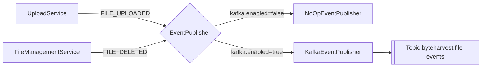

# Kafka feed (optional, local only)

A small learning feature. When it is on, the master publishes **two activities** to a Kafka topic:

- `FILE_UPLOADED`: after a file is stored
- `FILE_DELETED`: after a file's metadata is deleted and its chunks have been removed from the nodes (best effort)

Nothing else uses Kafka. Heartbeats, uploads, downloads, repair and the event log all work exactly as before.

Kafka is **off by default**. The project runs the same without it, no broker is needed, and it is not part of `compose.prod.yaml` or any deployment. The master image does contain the `spring-kafka` library, but it does nothing unless `KAFKA_ENABLED=true`.

## How it fits in



- The two services call the `EventPublisher` interface and do not know whether Kafka exists (the same idea as `PlacementStrategy` and `StorageNodeClient`). Spring chooses the implementation once at startup from `kafka.enabled`: `NoOpEventPublisher` (does nothing) by default, `KafkaEventPublisher` when it is `true`. Only one of the two beans exists at a time.
- Publishing is **best effort**. It is asynchronous, the producer waits at most 2 seconds for a missing broker, and a failure is only logged as a warning. An upload or a delete never fails because Kafka is down.
- An upload event is sent when the upload finishes. A delete event is sent after the delete has committed.

## The message

- **Topic:** `byteharvest.file-events` (3 partitions, 1 replica; created on startup when Kafka is enabled)

A message is just **two strings**:

| | Example |
| --- | --- |
| Key | the `fileId`, for example `123e4567-e89b-12d3-a456-426614174000` |
| Value | the event name: `FILE_UPLOADED` or `FILE_DELETED` |

Events with the same key go to the same partition, so one file's `FILE_UPLOADED` is always read before its `FILE_DELETED`. There is no JSON; a consumer that needs the filename or size can look the file up by its `fileId`.

## Run it

Only the master needs to know about Kafka. Pick one way:

**Master from IntelliJ, broker in Docker (simplest)**

```bash
docker compose -f compose.kafka.yaml up -d
```

Add the environment variable `KAFKA_ENABLED=true` to the master's run configuration. It connects to `localhost:9092`.

**Everything in Docker**

1. Add `KAFKA_ENABLED=true` to `.env`.
2. Start with both files:

```bash
docker compose -f compose.yaml -f compose.kafka.yaml up --build
```

## See the events

Upload a file and delete it in the dashboard, then read the topic:

```bash
docker exec -it byteharvest-kafka /opt/kafka/bin/kafka-console-consumer.sh \
  --bootstrap-server localhost:9092 --topic byteharvest.file-events --from-beginning \
  --property print.key=true
```

See partitions and offsets:

```bash
docker exec -it byteharvest-kafka /opt/kafka/bin/kafka-topics.sh \
  --bootstrap-server localhost:9092 --describe --topic byteharvest.file-events
```

Things to try:

- Upload two files and note which partition each fileId lands in. The same file always goes to the same one.
- Stop the broker (`docker stop byteharvest-kafka`) and upload a file. The upload still works and the master logs a warning. Start it again and new events flow. Events sent while it was down are not replayed.

## Settings

| Variable | Default | Purpose |
| --- | --- | --- |
| `KAFKA_ENABLED` | `false` | Turns publishing on |
| `KAFKA_BOOTSTRAP_SERVERS` | `localhost:9092` (`kafka:19092` in `compose.yaml`) | Broker address |
| `KAFKA_FILE_EVENTS_TOPIC` | `byteharvest.file-events` | Topic name |

## Limits

- Producer only. Nothing in the project consumes the topic yet.
- Single broker, no replication, no security (plain text). It is meant for a laptop.
- Messages are dropped, not queued, if the broker is down or slow.
